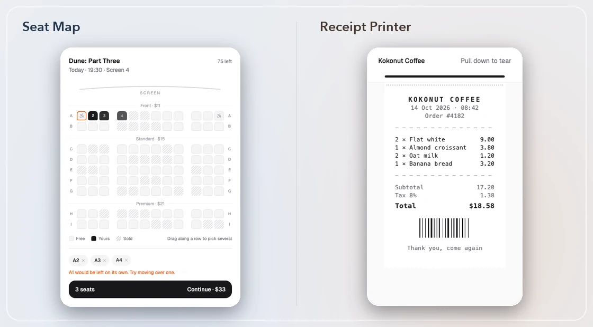

<h1 align="center">MotionUX</h1>

<p align="center"><strong>The motion intelligence layer for AI-built interfaces.</strong></p>

<p align="center">
  Start with real motion. Try a gesture, compare the original, and bring the interaction into your own product.
  We’re building toward a way for people and coding agents to choose motion with the same care.
</p>

<p align="center">
  <a href="#get-started">Open Studio</a> ·
  <a href="#try-the-motion">Try the motion</a> ·
  <a href="docs/ROADMAP.md">Product roadmap</a>
</p>

<p align="center">
  <a href="#try-the-motion">
    
  </a>
</p>

## Try the motion

[](docs/readme/receipt-in-motion.gif)

[Watch the receipt print](docs/readme/receipt-in-motion.gif). Open either demo in Studio to try it yourself.

- **Feel the interaction.** Browse live previews in Gallery. Open Playground to try an interaction at phone width, or use Compare to see the pinned upstream example, Studio and a separately installed consumer.
- **Keep what fits.** Save favorites, build a collection for a project and leave yourself a note in My Library.
- **Take it into your app.** Open Code, Usage and Install for the selected original. Export a shortlist with its setup instructions through Project Kit.

## Where MotionUX is going

An animation can clarify where you are, confirm an action, or help you follow a change. Sometimes the clearest interaction is immediate. MotionUX is building toward recommendations that explain the difference and show how to verify the result in your app.

| Product | Status | What it does |
| --- | --- | --- |
| **Studio** | Available locally | Discover, try, compare and collect pinned implementations. |
| **Brain** | Planned | Find suitable motion by intent, explain the evidence and recommend stillness when it fits. |
| **Agent** | Planned | Help Codex scope, integrate and verify an interaction. Local MCP tooling follows the CLI. |
| **Motion DNA** | Planned | Record how motion should feel and behave in a specific product. |
| **Inspector** | Planned | Find motion and accessibility issues on real routes and compare evidence before and after. |

**Future workflow concept**

> Review our booking flow. Find calm motion that makes the next step clearer and fits our design language. Use an original component if it helps. Check touch, keyboard, reduced motion and performance on the real screen.

[Read the product roadmap](docs/ROADMAP.md)

## Get started

Install the workspace dependencies. If this is your first run, prepare the local sources using the setup guide. With the vault prepared, start Studio.

```sh
npm ci
npm run studio
```

[First-run setup and installation](docs/DEVELOPER-GUIDE.md#set-up-studio) · [Open Studio on this computer](http://127.0.0.1:5199/)

The prepared Studio includes pinned React originals and standalone HTML examples in sandboxed React hosts. GitHub contains the Studio, source references and the public registry. Original payloads and previews are prepared locally in the ignored `.motionux-v9/` vault. Each original retains its upstream attribution and applicable notices. The public `v1.0.0` registry has its own four stable MotionUX entries under the MIT license. [Local originals](docs/V14-ORIGINALS.md) · [Public registry](docs/COMPONENTS.md) · [MotionUX license](LICENSE)

[Design principles](docs/DESIGN-PRINCIPLES.md) · [Quality gates](docs/QUALITY-GATES.md) · [Studio scaling evidence](docs/V13-1-PERFORMANCE.md)
