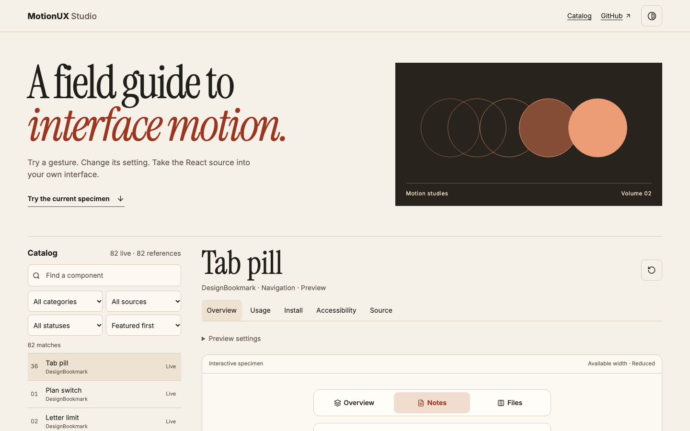

# MotionUX

**Make everyday interactions feel finished.**

Give people a clear cue when they change pages, open a detail, or finish a task. MotionUX is a shadcn registry for React teams that want thoughtful motion and accessible interaction without redesigning their product. Install one component, style it with your own tokens, and edit the source right in your project.

[Install your first component](#quick-start) · [Browse the components](#components) · [Run the interactive demo](#try-the-demo) · [View v1.0.0](https://github.com/SapienXai/MotionUX/tree/v1.0.0)

[](#try-the-demo)

- **Keep your design.** MotionUX supplies interaction behavior and timing. Your app sets the colors, typography, layout, and copy.
- **Own the code you ship.** The shadcn CLI copies TypeScript and CSS into your project from the tagged GitHub registry. Review the diff and adapt the files as your product evolves. The app runs with those local files.
- **Make the interaction work at rest.** The dock and disclosure use native controls. The status pill keeps its message visible through transitions. All three respect system reduced-motion preferences.

## Quick start

In a React 19 project with an existing shadcn `components.json`, add the disclosure:

```sh
npx shadcn@latest add 'SapienXai/MotionUX/motion-disclosure#v1.0.0'
```

Then render it anywhere you would otherwise use a details element. This example assumes `aliases.components` is `@/components`. Adjust the import to match yours.

```tsx
import { MotionDisclosure } from "@/components/sapienx-motion/motion-disclosure";

export function DeliveryDetails() {
  return (
    <MotionDisclosure label="Delivery and returns">
      <p>Orders ship in two business days. Returns are accepted within 30 days.</p>
    </MotionDisclosure>
  );
}
```

Click the label or focus it and press Enter. The details open with a short transition when motion is enabled. The component imports its companion CSS. Pass `className` to fit it into your layout.

<details>
<summary>Preview changes or use pnpm</summary>

```sh
npx shadcn@latest view 'SapienXai/MotionUX/motion-disclosure#v1.0.0'
npx shadcn@latest add 'SapienXai/MotionUX/motion-disclosure#v1.0.0' --dry-run
pnpm dlx shadcn@latest add 'SapienXai/MotionUX/motion-disclosure#v1.0.0'
```

The CLI installs into the `sapienx-motion/` subdirectory of your configured component alias. If your app has no `components.json`, set one up using its existing aliases and stylesheet. [shadcn configuration reference](https://ui.shadcn.com/docs/components-json)

</details>

## Components

| Component | Reach for it when… |
| --- | --- |
| [`motion-dock`](components/motion-dock.tsx) | Your mobile navigation needs a subtle cue for the active destination. Pass in your own links and set `aria-current` from your router. |
| [`motion-disclosure`](components/motion-disclosure.tsx) | Details such as delivery terms, room photos, or advanced options should stay out of the way until someone asks for them. |
| [`motion-status-pill`](components/motion-status-pill.tsx) | Someone needs to know whether an operation is pending, succeeded, or failed. Pass in the real state and a localised label. Use `announce` for a single changing result. |
| [`motion-foundations`](components/motion-provider.tsx) | You want consistent feedback timing and springs for your own animations. The status pill installs this dependency automatically. |

Use the same `SapienXai/MotionUX/<item>#v1.0.0` format to install any of these. The catalog covers dependencies, API details, and source attribution. [Component catalog](docs/COMPONENTS.md)

## Try the demo

Run MotionUX Studio to explore 82 live interactions, from a moving tab indicator and a swipeable deck to form controls and a local audio player. Open a specimen to try it, change the theme or viewport, compare reduced motion, and inspect its React API or pinned install. Use the local URL printed by Vite.

```sh
git clone https://github.com/SapienXai/MotionUX.git
cd MotionUX
npm ci
npm run dev
```

The registry has test coverage for keyboard, touch, and reduced motion across Chromium and WebKit. The verification report records what was tested in the demo and in product pilots. [Mobile screenshot](docs/evidence/motionux-registry-webkit.png) · [Verification report](docs/VERIFICATION.md)

## Use with Codex

The optional MotionUX skill gives Codex a repeatable workflow for selecting a component, previewing a pinned install, and adapting it to the current app. Copy the `skills/sapienx-motion-system` folder into `~/.agents/skills/`, then ask Codex to use `$sapienx-motion-system` on an interaction in your project. The included AGENTS section makes it a default for SapienX UI work. [Skill source](skills/sapienx-motion-system/SKILL.md) · [AGENTS section](skills/global-agents-section.md)

## License

MotionUX is open source under MIT. Adapted components retain their upstream notices. [License](LICENSE) · [Source review](docs/SOURCE-REVIEW.md)

## MotionUX Studio development

Studio previews are available at exact commit SHAs while their visual and adoption reviews continue. The four tagged v1 items are the stable release. Open `/?item=designbookmark-swipe-deck#specimen` for a drag interaction, `/?item=kokonut-signature-pad#specimen` for a form control, or `/?legacy=1` for the original examples.

Use the Studio Install view for the exact pin. Update a vendored component by inspecting the newer pin with `shadcn view` and `add --dry-run`, then reconcile the diff with your local changes. See the [release checklist](docs/RELEASE.md) and [changelog](CHANGELOG.md).

[Implementation status](docs/IMPLEMENTATION-STATUS.md) · [Reference inventory](docs/REFERENCE-INVENTORY.md) · [Studio design](DESIGN.md)
