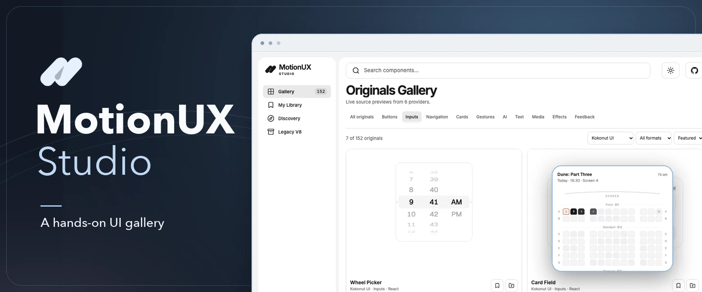

  

<h1 align="center">Try 152 interactive components</h1>

  Flick a time picker, choose a cinema seat, or tear a freshly printed receipt. 
  MotionUX lets you explore how an interface feels before you use it.

  <strong><a href="#get-started">Get started</a></strong>
  &nbsp;·&nbsp;
  <a href="#see-it-in-motion">See it in motion</a>

## See it in motion

[Watch the receipt print](docs/readme/receipt-in-motion.gif). Both demos are available to try in Studio.

## Find something worth keeping

**Explore at your own pace.** Browse the Originals Gallery and try components right on their cards. Open Playground for more room to replay a gesture and see how it feels at phone size.

**Keep the good finds close.** Favorite a component or make a collection for a project. Add a note about what worked, then find it again in My Library.

**Bring your shortlist into a project.** Use Project Kit to share your picks and their setup instructions with your team. [How Studio and Project Kit work](docs/V11-IMPLEMENTATION.md)

## Get started

**New to MotionUX?** Follow the [Studio setup guide](docs/DEVELOPER-GUIDE.md#set-up-studio) to prepare the gallery on your computer.

**Studio already running?** [Open MotionUX Studio](http://127.0.0.1:5199/) on the same computer.

[Explore the new V12 collection](docs/V12-ORIGINALS.md) · [Installation and developer guide](docs/DEVELOPER-GUIDE.md) · [License](LICENSE)
