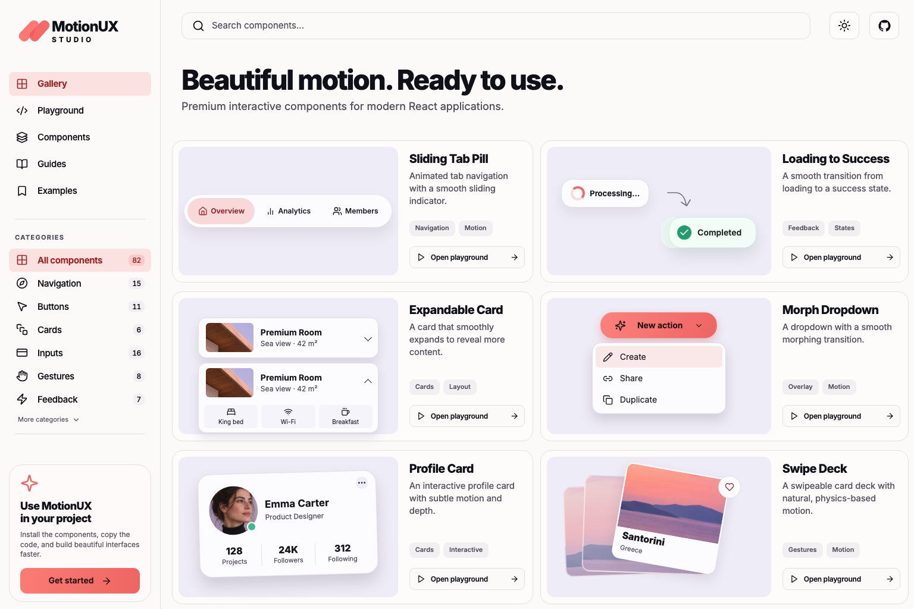

# MotionUX

**Give your interface a sense of touch.**

A tab indicator that follows the selection. A card deck that moves with your drag. A confirmation button that gives you time to change your mind. MotionUX is a shadcn registry of these interactions for React. Try them in Studio, then install the TypeScript and CSS for the one you want to make your own.

[Run Studio](#run-motionux-studio) · [Install a component](#install-your-first-component) · [Browse all 82 previews](docs/REFERENCE-INVENTORY.md) · [Use with Codex](#use-with-codex)

[](#run-motionux-studio)

## Run MotionUX Studio

Explore **82 interactive previews** across navigation, feedback, forms, gestures, typography, AI interfaces, and media.

```sh
git clone https://github.com/SapienXai/MotionUX.git
cd MotionUX
npm ci
npm run dev
```

Open the local URL printed by Vite. Try a live card in Gallery, click **Open playground**, and open **Preview settings** to switch between neutral, BookPlace, and DineWallet themes, try a narrower stage, or compare reduced motion. Use **Install** for the pinned command and **Usage** for the React example. **Code** lets you inspect and copy the component’s TypeScript and CSS. **Source** links the reference and the component test.

| Try first | What to do |
| --- | --- |
| **Tab Pill** | Use the arrow keys or click a tab. Watch the indicator follow the selected panel. |
| **Swipe Deck** | Drag a card across the stage. The previous and next buttons offer the same navigation. |
| **Signature Pad** | Draw a stroke, undo it, or enter a typed signature. |
| **Glass Player** | Play, pause, and seek a local audio sample. |

[Desktop reference comparison](docs/evidence/studio-v5/reference-comparison.png) · [Mobile Gallery](docs/evidence/studio-v5/mobile-390-light.png) · [See the Playground](docs/evidence/studio-v5/playground-desktop.png)

## Install your first component

The **stable registry** contains four entries at [`v1.0.0`](https://github.com/SapienXai/MotionUX/tree/v1.0.0). The **Studio catalog** contains 82 installable previews pinned to Git commits. Each preview has a working demo and a behavior test. Per-component visual and device acceptance remains in review, and v2 has yet to be released. [Component catalog](docs/COMPONENTS.md) · [Acceptance status](docs/IMPLEMENTATION-STATUS.md)

### Start with the stable disclosure

In a React 19 project with a shadcn `components.json`, run:

```sh
npx shadcn@4.23.0 add 'SapienXai/MotionUX/motion-disclosure#v1.0.0'
```

```tsx
import { MotionDisclosure } from "@/components/sapienx-motion/motion-disclosure";

export function RoomDetails() {
  return (
    <MotionDisclosure label="What’s included">
      <p>Breakfast, late checkout, and access to the rooftop terrace.</p>
    </MotionDisclosure>
  );
}
```

The disclosure uses native `details` and `summary`. Click it or focus the label and press Enter. The example assumes the component alias is `@/components`. Match the import to your project’s alias. [shadcn configuration](https://ui.shadcn.com/docs/components-json)

### Try the animated Tab Pill preview

```sh
npx shadcn@4.23.0 add 'SapienXai/MotionUX/tab-pill#03173314f6e8ce3c69ff448930d3278a9af90822'
```

```tsx
"use client";

import { TabPill } from "@/components/sapienx-motion/motion-selector";

export function ProjectTabs() {
  return (
    <TabPill
      label="Project sections"
      options={[
        { value: "overview", label: "Overview", panel: <p>Project summary</p> },
        { value: "notes", label: "Notes", panel: <p>Working notes</p> },
      ]}
    />
  );
}
```

## Make it fit your app

- **Keep your visual identity.** Use your product’s colors and typography. Studio preview components expose CSS custom properties for surfaces, text, borders, accents, and selected states. [Theme and motion tokens](docs/MOTION-TOKENS.md)
- **Keep application state in your app.** Give controls their labels, links, and callbacks. Pass the actual result into feedback components so the user sees whether an operation is pending, succeeded, or failed.
- **Review code like any other change.** shadcn installs source and companion CSS under your configured component alias. Use `view` to inspect the item and `add --dry-run` to see what would change. Update by comparing a newer pin with your local files. [GitHub registry guide](https://ui.shadcn.com/docs/registry/github) · [Update and release workflow](docs/RELEASE.md)

## Use with Codex

Copy the [`sapienx-motion-system` skill folder](skills/sapienx-motion-system) into `~/.agents/skills/` and start a new Codex session. Give it a real interaction to work on.

> Use $sapienx-motion-system to add a keyboard-accessible room details disclosure. Keep the hotel’s existing theme. Inspect the pinned MotionUX component before installing it.

For automatic use on SapienX React and Next.js work, merge the [AGENTS.md section](skills/global-agents-section.md) into your existing rules.

## Verification and license

Studio V5 passed **306 browser checks** across desktop Chromium, touch Chromium, and iPhone-profile WebKit. The registry smoke test installed and typechecked **86 registry entries** in a clean React project. The V5 report includes the 1536 × 1024 reference comparison and the first-viewport performance measurements. [V5 verification](docs/STUDIO-V5-VERIFICATION.md) · [GitHub Actions](https://github.com/SapienXai/MotionUX/actions/workflows/ci.yml?query=branch%3Amain) · [Registry verification](docs/VERIFICATION.md)

MotionUX is MIT licensed. Adapted components retain their upstream notices. [License](LICENSE) · [Source review](docs/SOURCE-REVIEW.md) · [Changelog](CHANGELOG.md)
