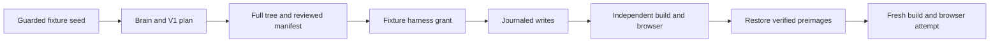

# MotionUX Agent V3

Agent V3 installs a reviewed original into a generated copy of a checked-in fixture, verifies it in an independent build, restores the target, and verifies the restored screen. It uses the existing Brain index, Agent V1 project inspection and the private source registry. The V1 MCP tools continue to provide discovery and planning.

## Run a fixture

Use Node 24, the prepared 500-original vault, the pinned dependencies, and Playwright Chromium, Firefox and WebKit. Real builds currently use the existing macOS process sandbox. Public tests use synthetic transactions and can run on Linux.

```sh
npm ci
npm run brain:index
npm run agent:v3:seed-cache
npm run agent:v3:doctor
npm run --silent agent:v3:review -- --request fixtures/agent/v3/requests/next-disclosure.json --json
npm run --silent agent:v3:dry-run -- --review RUN_ID --json
npm run --silent agent:v3:fixture-evaluate -- --review RUN_ID --json
npm run --silent agent:v3:status -- --run RUN_ID --json
npm run --silent agent:v3:rollback -- --run RUN_ID --recheck --json
npm run --silent agent:v3:evaluate -- --json
npm run test:agent:v3
```

The seed command copies integrity-verified tarballs from the existing local npm cache into the shared private offline cache. It reports missing pinned tarballs. The harness installs the reviewed postimage lock in a fresh replica before it mints a grant. Cache provisioning is separate from acceptance. The runner uses offline npm with lifecycle scripts disabled and resolves against the reviewed npm lockfiles. The fixture runner supports a fixed Next.js or Vite build command. It uses the dedicated loopback port for browser verification. Desktop, touch and reduced-motion results describe the named browser profiles.

The Next.js fixture integrates [Animate UI Accordion](https://github.com/imskyleen/animate-ui/blob/22a9236ae107328f8564edb7e3299375da3247af/apps/v1/apps/www/registry/components/base/accordion/index.tsx) on `/details`. The server page supplies the room details. The client view passes those values to the original accordion and uses its transition prop for reduced motion. The Vite fixture integrates [Kokonut Wheel Picker](https://github.com/kokonut-labs/kokonutui/blob/d8162dfe2c052a796a74d217b1f06511f213e4e0/components/kokonutui/wheel-picker.tsx) into `src/Screen.tsx`. The screen retains the selected time and receives the picker’s settled value. The runtime import closure, pin, upstream and installed hashes, applicable notices and upstream CSS references are tracked in the private review. The host stylesheet keeps its own theme.

`next-static.json` selects the inline checkout error and returns `no-motion` with zero target writes. The React 18 pin of Motion Primitives Disclosure is incompatible with the Next.js fixture’s fixed React version. Unsupported sources and unverified required accessibility capabilities fail closed.

## Scope and recovery



The reviewed path is generated from a private run ID and bound to its canonical device, inode and permissions. The full manifest records create and modify operations, directory modes, file roles, hashes, sizes, and exact dependency changes. The presentation diff and content-addressed preimages stay under `.motionux-v9/evidence/agent-v3/runs/<run-id>/`. Dry-run checks the full target, including untracked files within the fixture, and writes zero target files.

The fixture harness creates an opaque, process-bound grant. It binds the root identity, route or file, run, revision, manifest, expiry, one-time nonce, and reviewed operation permissions. A review hash can be inspected independently. The grant expires or is consumed once. The harness is limited to generated MotionUX fixtures and the subprocesses run inside a macOS sandbox. A process with the same OS user’s broader shell and filesystem privileges is outside this authority boundary.

Apply revalidates its lock, grant, source, full target state and reviewed preimage before each effect. Failure or cancellation triggers rollback. Explicit rollback can recover after an interrupted writer. A conflicting third-party edit or damaged snapshot yields `needs-manual-review` or a failed command, and the conflicting content is preserved. Each `--recheck` performs a fresh build and browser run with a unique attempt ID. Failed attempts exit nonzero and keep previous evidence distinguishable.

Each build uses a separate disposable replica, capped at a single active build and checked against an 850 MiB allocated-block budget. Temporary installs and builds are removed after verification. Private journals, pin evidence and selective screenshots and traces remain. CPU totals and JS heap in Chromium are sampled with CDP. Renderer RSS is unknown under the process sandbox. Physical mobile, manual screen readers, RTL and live backends are open.

## Real project writes

`REAL_PROJECT_WRITES_DISABLED` is the current runtime behavior. Codex CLI’s app-server schema includes approval prompts for commands, file changes, and permissions. V3 has no independently verified channel that ties a real human approval to a signed MotionUX manifest grant. The proposed [host claim](../schemas/agent/v3/host-grant.json) describes the data a future trusted issuer must bind. A production integration also needs verification at execution time, revocation, replay protection, and a host-enforced boundary. The existing [MCP](MCP-V1.md) remains read-only.
