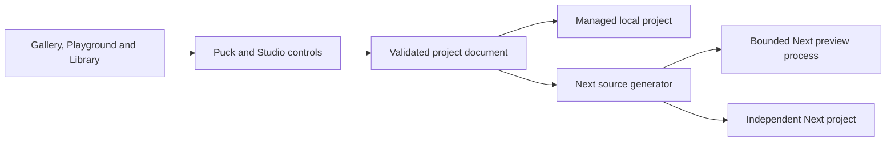

# Build architecture

The transition keeps the Vite-era Gallery and library at port 5199. A native Next App Router shell serves new product routes at port 5200. Navigation uses explicit links between the two loopback services. Existing API origin checks stay in place. The legacy npm lock and fixture-specific npm locks remain authoritative for their lanes. The platform workspace has its own pnpm lock, without a second copy of Brain, Agent, MCP or the original vault.

The editor uses Puck for drag/drop and rendering. Puck data is a projection of the project document. The project document owns page IDs, ordering and editable block props. App Blocks and design tokens are shared with exported source. Generated React is a one-way export. Node processes own the filesystem and live preview boundary. No Turborepo is needed for the current dependency graph.

## Versions and decisions

| Boundary | Pin | Decision |
| --- | --- | --- |
| Platform installs | pnpm 10.30.3 | `platform/pnpm-lock.yaml` is authoritative for workspace packages. The root keeps existing npm commands. |
| Studio and export | Next.js 16.4.6, React 19.3.1 | App Router for native Build, dashboard and API routes. Workspace packages use Next's transpilation. |
| Visual editor | Puck 0.24.0, MIT, React peer `^18.0.0 \|\| ^19.0.0` | Puck runs only in the Build editor chunk. The editor uses its drag/drop, selection and render contracts. Keyboard commands use the same ordered block data. |
| Standalone styling | Tailwind 4.3.5 | Exports include the pinned PostCSS integration and the same CSS/tokens as the editor. |
| Live preview | Next production subprocess on 5202 | Build one saved revision at a time. The iframe and independent browser route render the generated app. |

Canvas supports ordered page blocks and one nested slot level inside the sidebar inset. No arbitrary HTML, nested user slots or arbitrary TSX imports are supported. The managed documents declare the demo dataset and contain typed presentation props, optional accessibility labels, and a metric choice for individual KPI cards. Filesystem asset ingestion and arbitrary data bindings are later capabilities. V1 ships 31 owned blocks; image gallery is deferred until the managed asset policy is implemented. Private originals are available through the separate catalog with their existing rights and evidence.

References: [Puck Editor](https://puckeditor.com/docs), [Next transpilePackages](https://nextjs.org/docs/app/api-reference/config/next-config-js/transpilePackages), [pnpm workspaces](https://pnpm.io/workspaces/), [legacy Vite options](https://vite.dev/config/server-options), [shadcn/ui block reference](https://ui.shadcn.com/blocks). The app blocks are independently implemented; the shadcn examples are design references.
