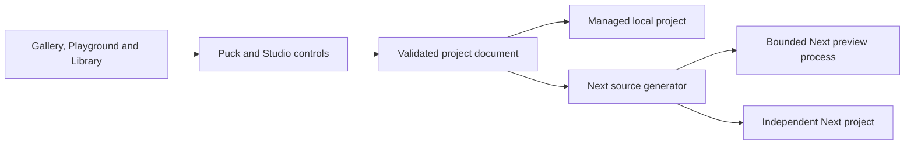
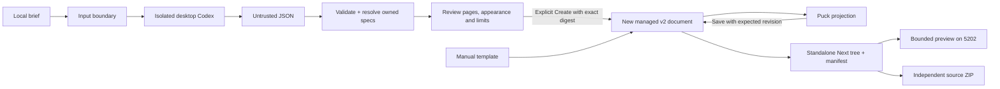

# Build architecture

The transition keeps the Vite-era Gallery and library at port 5199. A native Next App Router shell serves new product routes at port 5200. Navigation uses explicit links between the two loopback services. Existing API origin checks stay in place. The legacy npm lock and fixture-specific npm locks remain authoritative for their lanes. The platform workspace has its own pnpm lock, without a second copy of Brain, Agent, MCP or the original vault.

The editor uses Puck for drag/drop and rendering. Puck data is a projection of the project document. The project document owns page IDs, ordering and editable block props. App Blocks and design tokens are shared with exported source. Generated React is a one-way export. Node processes own the filesystem and live preview boundary. No Turborepo is needed for the current dependency graph.

## Versions and decisions

| Boundary | Pin | Decision |
| --- | --- | --- |
| Platform installs | pnpm 10.30.3 | `platform/pnpm-lock.yaml` is authoritative for workspace packages. The root keeps existing npm commands. |
| Studio and export | Next.js 16.4.6, React 19.3.1 | App Router for native Build, dashboard and API routes. Workspace packages use Next's transpilation. |
| Visual editor | Puck 0.24.0, MIT, React peer `^18.0.0 \|\| ^19.0.0` | Puck runs only in the Build editor chunk. The editor uses its drag/drop, selection and render contracts. Keyboard commands use the same ordered block data. |
| Standalone styling | Tailwind 4.3.5 | Exports include the pinned PostCSS integration and the same CSS/tokens as the editor. |
| Live preview | Next production subprocess on 5202 | Build one saved revision at a time. The iframe and independent browser route render the generated app. |

Canvas supports ordered page blocks and one nested slot level inside the sidebar inset. No arbitrary HTML, nested user slots or arbitrary TSX imports are supported. The managed documents declare the demo dataset and contain typed presentation props, optional accessibility labels, and a metric choice for individual KPI cards. Filesystem asset ingestion and arbitrary data bindings are later capabilities. V1 ships 31 owned blocks; image gallery is deferred until the managed asset policy is implemented. Private originals are available through the separate catalog with their existing rights and evidence.

References: [Puck Editor](https://puckeditor.com/docs), [Next transpilePackages](https://nextjs.org/docs/app/api-reference/config/next-config-js/transpilePackages), [pnpm workspaces](https://pnpm.io/workspaces/), [legacy Vite options](https://vite.dev/config/server-options), [shadcn/ui block reference](https://ui.shadcn.com/blocks). The app blocks are independently implemented; the shadcn examples are design references.

## B3 composition and export

`build-core/model.ts` defines the ordered page/block graph, adapter/template mapping, block versions, compatible metric bindings and rights. The B3 spec layer names supported actions and runtime contracts; blocks execute their fixed handlers. `app-blocks/profile.ts`, hotel fixtures and `crm-data.ts` provide domain-specific semantics in a shared frame. CRM adds directory, pipeline, breakdown and activity modules. The pipeline derives totals and KPIs from the same typed opportunity rows. Its stage overrides persist in browser storage scoped to project ID and document revision. Hotel semantics remain unchanged. Blank uses no domain fixture.

A v1 Hotel project is normalized into v2 on read without writing anything. An explicit Save checks its revision and backs up the exact previous bytes before replacing the file. Invalid docs fail closed and can recover the prior valid document. Blueprint provenance follows the project through saves, and proposal metadata is excluded from the independent export.

The Composer modules separate the native process, input/output contract and proposal compiler, and review service. The server owns route and adapter choices, safe effects and the plan digest. Review and app descriptions come from verified route and block capabilities; the model can propose names, headings and block choices. Its in-memory receipt authorizes exactly one managed Create. Compiling an identical normalized proposal and review gives the same semantics, independently of model nondeterminism.

The landing does not mount Puck until a project opens. Next uses a shared catch-all scaffold with statically generated, validated routes: one source graph with no AI-generated filenames or duplicated route implementations. The ZIP keeps its independent `npm ci` lock, shared owned React modules and a source inventory; the manifest ties the block spec, chosen data, runtime pins and file hashes to the document digest. Run invokes the same exporter and checks the digest returned from the Next process on loopback.

## B4 PWA export

The PWA variant uses the same validated project and block implementations as the standard ZIP. It adds the install manifest, icons, worker source and a production build script. The script stamps a worker with the saved routes and the actual hashed static assets. Routes use normal document links so the cache can return the same prerendered HTML and assets offline, including first visits to saved routes. The isolated Studio Run uses the same standard export as before. See [PWA export](BUILD-PWA.md).

## B5 Motion DNA

The optional, versioned settings belong to the existing project document. The shared app frame maps validated durations and easing names to CSS tokens for the Studio canvas, the Next preview, and both export formats. The manifest records the configured profile and the shared CSS resolves the viewer's current reduced-motion preference. Loading an older document doesn't write a migration or change its digest. See [Motion DNA](BUILD-MOTION-DNA.md).

## B6 Inspector

The editor requests a read-only snapshot of one page from an active Run. The preview host matches the project ID, revision and document digest before spawning a bounded local Chromium worker. Fresh contexts measure the actual page, run axe and exercise the shared page search. The worker produces structured viewport findings for Studio. The worker and report UI stay outside the generated application tree. See [Inspector](BUILD-INSPECTOR.md).
